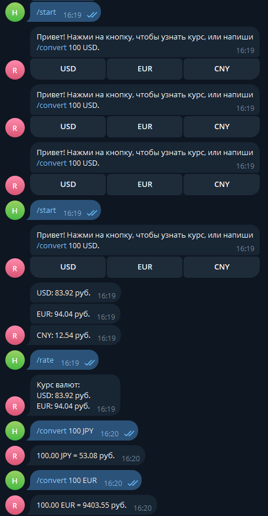

# currency_rate_bot

Telegram-бот на Python (aiogram), который показывает актуальные курсы валют
Центрального банка РФ и конвертирует суммы в рубли.

## Возможности

- `/start` — приветствие и кнопки быстрого доступа (USD, EUR, CNY)
- `/rate` — курс доллара и евро к рублю
- `/convert 100 USD` — перевод суммы в рубли по курсу ЦБ (поддерживаются все валюты из списка ЦБ)
- Inline-кнопки: нажатие на валюту присылает её курс
- Обработка неверного ввода: бот подсказывает формат команды, а не падает
- Корректный расчёт курса с учётом номинала (например, для иены, юаня и других валют)
- Сообщение об ошибке, если сервис ЦБ недоступен

## Скриншот

<!-- Добавьте сюда скриншот переписки с ботом:

-->

## Технологии

- Python 3
- [aiogram 3](https://docs.aiogram.dev/) — работа с Telegram Bot API
- requests — получение данных с `cbr-xml-daily.ru`
- python-dotenv — хранение токена в файле `.env`

## Установка и запуск

1. Клонируйте репозиторий и перейдите в папку проекта:
   ```
   git clone https://github.com/foxyk19/currency_rate_bot.git
   cd currency_rate_bot
   ```
2. (Рекомендуется) создайте виртуальное окружение и активируйте его:
   ```
   python -m venv .venv
   .venv\Scripts\activate
   ```
   На Linux и macOS: `source .venv/bin/activate`
3. Установите зависимости:
   ```
   pip install -r requirements.txt
   ```
4. Создайте бота в Telegram через [@BotFather](https://t.me/BotFather) командой `/newbot` и получите токен.
5. Создайте файл `.env` по образцу `.env.example` и впишите свой токен:
   ```
   BOT_TOKEN=ваш_токен
   ```
6. Запустите бота:
   ```
   python bot.py
   ```

Бот работает, пока запущен скрипт. Остановить: `Ctrl + C`.

## Структура проекта

```
├── bot.py              # код бота
├── requirements.txt    # зависимости
├── .env.example        # шаблон файла с токеном
└── .gitignore          # исключает .env и служебные файлы
```

## Безопасность

Токен бота хранится только в файле `.env`, который добавлен в `.gitignore`
и не попадает в репозиторий.

## Источник данных

Курсы валют: [cbr-xml-daily.ru](https://www.cbr-xml-daily.ru/) (данные Центрального банка РФ).

## Планы по развитию

- Кеширование курсов, чтобы не обращаться к API при каждом запросе
- Конвертация между двумя произвольными валютами
- Избранные валюты пользователя (SQLite)
- Запуск на сервере для работы 24/7
